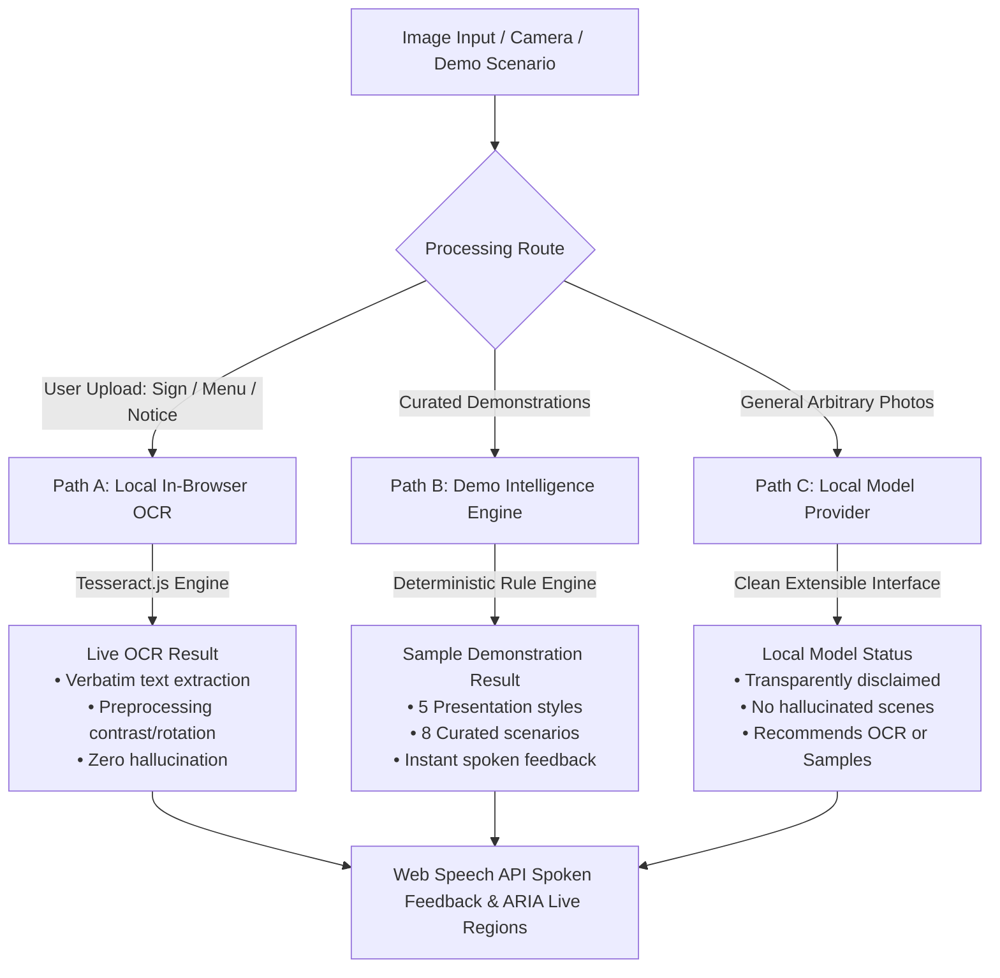

# SeeAble AI — Your surroundings, explained.

> **AI Accessibility & Assistive Technology Platform | Hackathon Working Prototype**  
> 100% Offline-Ready &bull; Zero Paid Cloud APIs &bull; Honest Assistive AI &bull; Web Speech API Feedback

---

## 🌟 Mission & Overview

**SeeAble AI** is an inclusive, accessible web application designed to help people who are blind or have low vision understand visual information in their surroundings.

Whether reading announcements on a college campus, navigating public transit bus stops, inspecting consumer food package labels, checking a bistro menu, or sorting waste into correct recycling bins, SeeAble AI provides instant spoken feedback, structured scene explanations, and faithful optical character recognition (OCR).

### Target Audiences
- **People with low vision** needing high-contrast, scalable text and visual enhancements.
- **Blind individuals** who rely on screen readers (JAWS, NVDA, VoiceOver) and synthesized voice feedback.
- **Students & Lifelong Learners** reading academic flyers, classroom whiteboards, and educational notices.
- **Citizens & Transit Riders** navigating indoor municipal buildings, directories, and public transit schedules.
- **Eco-Conscious Individuals** sorting waste accurately to prevent recyclable stream contamination.
- **Hackathon Judges** evaluating accessibility architecture, UX fidelity, and social impact without flaky external cloud dependencies.

---

## 🏛️ Architecture: 3 Transparent Processing Paths

SeeAble AI enforces **Honest AI Behavior** with strict separation of processing methods:



### 1. Path A — Local Browser OCR (Tesseract.js)
- Genuine client-side Optical Character Recognition.
- **No external OCR servers or paid computer vision endpoints.**
- Faithful, verbatim text output: does not rewrite, invent words, or guess illegible text.
- Built-in canvas preprocessing: **Rotation (0°, 90°, 180°, 270°)**, **Grayscale filter**, and **Contrast tuning**.
- Line-by-line breakdown, confidence score, copy-to-clipboard, and plain `.txt` file export.

### 2. Path B — Demonstration Intelligence Engine (`src/services/demoEngine.ts`)
- Curated deterministic engine with **8 diverse scenarios**:
  1. *College Campus Notice* (Event announcement & RSVP)
  2. *Bus Stop Information* (Route 42 scheduled departures & wheelchair ramp)
  3. *Classroom Whiteboard* (Newton's 2nd Law, formulas & homework)
  4. *Food Packaging Label* (Organic oats, expiry date, allergen notice)
  5. *Cafe Lunch Menu* (Avocado toast, latte, prices & dietary flags)
  6. *Public Building Sign* (Civic center level 2 directory & amenities)
  7. *Smart Recycling Guide* (4-stream waste diversion connecting accessibility with sustainability)
  8. *Public Library Board* (Operating hours, 24/7 book drop & assistive tech)
- Offers **5 distinct description styles**:
  - `Quick Overview` (concise bullet)
  - `Detailed Description` (hierarchical spatial breakdown)
  - `Objects and Visible Text` (catalog of elements)
  - `Simple Language` (accessible plain phrasing)
  - `Educational Explanation` (pedagogical purpose and layout theory)

### 3. Path C — Local Vision Provider Interface (`src/services/visionProvider.ts`)
- Extensible `VisionProvider` abstraction ready for future on-device WebGPU/ONNX runtimes.
- Strictly adheres to **No Fake Completion**: if no neural model is installed locally, it honestly explains that general scene understanding is disabled and offers the sample scenarios or live OCR.

---

## 🔊 Spoken Feedback & Voice Controls (`src/services/speechService.ts`)

- **Built with Web Speech API** (`window.speechSynthesis`): zero cloud TTS keys required.
- **Overlap Prevention**: Cancels ongoing speech before starting a new utterance to prevent chaotic audio overlap.
- **One-Click Controls**:
  - `Speak Result`: Reads summary, details, and extracted text.
  - `Stop Speaking`: Immediate hard stop at any point.
  - `Repeat Last Answer`: Repeats latest spoken answer across any screen.
- **Voice Preferences**: Customize speech rate (0.5x to 2.0x), pitch, volume, and choose among available browser voices.

---

## ♿ Accessibility Settings Center (`src/components/SettingsModal.tsx`)

Accessible design is fundamental to SeeAble AI:
- **Typography Scale**: Standard (16px), Large (19px), and Extra Large (22px).
- **High-Contrast Theme**: Pure black canvas (#000000), bright neon focus cues (#FFFF00), and crisp borders.
- **Theme Modes**: Dark Navy (#081426) default and Light High-Clarity mode.
- **Reduced Motion**: Respects `prefers-reduced-motion` and provides an explicit toggle.
- **Visible Keyboard Focus**: 3px high-contrast outline on all interactive surfaces.
- **ARIA Live Regions**: Dedicated polite (`role="status"`) and assertive (`role="alert"`) live announcers for screen readers.
- **Persistent Storage**: All settings are safely preserved in `localStorage` with fallback defaults.

### ⌨️ Global Keyboard Shortcuts

| Shortcut | Action |
| :--- | :--- |
| `Alt + 1` | Navigate to **Home** Overview |
| `Alt + 2` | Open **Describe My Surroundings** Workspace |
| `Alt + 3` | Open **Read Sign or Document (OCR)** Workspace |
| `Alt + 4` | Open **Demonstration Scenarios Library** |
| `Alt + S` | **Speak** / Read current result aloud |
| `Alt + X` | **Stop** speech playback immediately |
| `Alt + R` | **Repeat** last spoken answer |
| `Alt + A` | Open **Accessibility & Voice Settings** |
| `Alt + K` or `?` | Open **Keyboard Shortcuts Guide** |
| `Escape` | Close any open dialog or modal |

---

## 🚀 Running the Project

### Prerequisites
- Node.js LTS (v18+)
- Modern web browser (Chrome, Edge, Firefox, Safari, Opera)

### Development Server
```bash
npm install
npm run dev
```
Visit `http://localhost:3000` in your browser.

### Production Build
```bash
npm run build
npm run preview
```

---

## 🧪 Verification & Test Suite
The project includes a comprehensive offline automated test suite validating scenario data, determinism across all 5 description styles, honest fallback behavior, provider contracts, and speech bounds:
```bash
node dist-test/tests/runTests.js
# 68 PASSED, 0 FAILED
```

---

## 🛡️ Hackathon Prototype Disclosure
SeeAble AI was designed for social impact hackathons to prove how accessible multimodal interfaces can assist visually impaired individuals using transparent, privacy-first, on-device computing without costly external cloud dependencies.
